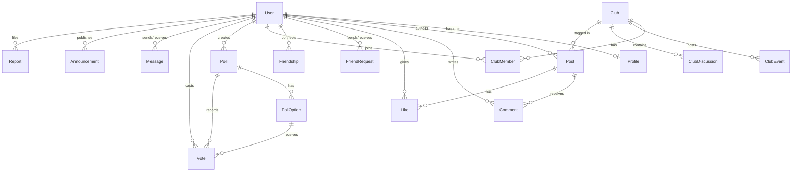

# SchoolConnect Database Schema Specification

The SchoolConnect database is engineered using **PostgreSQL** and managed with **Prisma ORM**.

---

## 1. Entity-Relationship Diagram (ERD)

---

## 2. Table Definitions

### 2.1 `Users`
| Field | Type | Attributes | Description |
|---|---|---|---|
| `id` | String | PK, cuid() | Unique identifier |
| `email` | String | Unique, Indexed | School email address |
| `password` | String | Bcrypt hash | Encrypted user password |
| `role` | Role Enum | STUDENT / TEACHER / ADMIN | Access authorization |
| `isVerified` | Boolean | Default: false | School email verification state |
| `verificationToken`| String? | Nullable | Token for verification email |
| `resetPasswordToken`| String? | Nullable | Token for password recovery |
| `resetPasswordExpires`| DateTime?| Nullable | Expiration timestamp |
| `isBlocked` | Boolean | Default: false | Admin suspension flag |
| `createdAt` | DateTime | Default: now() | Record timestamp |
| `updatedAt` | DateTime | Updated at | Record timestamp |

### 2.2 `Profiles`
| Field | Type | Attributes | Description |
|---|---|---|---|
| `id` | String | PK, cuid() | Unique identifier |
| `userId` | String | FK (User), Unique | Cascades on user deletion |
| `fullName` | String | Not null | Student/Teacher full name |
| `avatarUrl` | String? | Nullable | Profile avatar image link |
| `grade` | String? | Nullable | Class (e.g. "10th", "12th") |
| `section` | String? | Nullable | Section (e.g. "Section A") |
| `bio` | String? | Text | Personal student summary |
| `interests` | String? | Text | Hobbies & academic interests |
| `phone` | String? | Nullable | Contact number |

### 2.3 `Posts`
| Field | Type | Attributes | Description |
|---|---|---|---|
| `id` | String | PK, cuid() | Unique identifier |
| `authorId` | String | FK (User) | Author user |
| `content` | String | Text | Textual post body |
| `imageUrl` | String? | Nullable | Attached photo link |
| `clubId` | String? | FK (Club), Nullable | Associated school club |
| `hashtags` | String? | Nullable | Comma-delimited hashtags |
| `isModerated`| Boolean | Default: false | Flagged / hidden state |
| `createdAt` | DateTime | Indexed | Creation timestamp |

### 2.4 `Comments` & `Likes`
- `Comments`: Linked to `Post` (Cascade delete) and `User`.
- `Likes`: Enforces `@@unique([postId, userId])` to prevent duplicate likes.

### 2.5 `Clubs`, `ClubMembers`, `ClubEvents`, `ClubDiscussions`
- `Clubs`: Pre-seeded with 5 official clubs (Science, Eco, Coding, Sports, Arts).
- `ClubMembers`: Enforces `@@unique([clubId, userId])` with roles `MEMBER`, `MODERATOR`, `LEADER`.
- `ClubEvents`: Holds event date, campus location, and description.
- `ClubDiscussions`: Student thread inside dedicated club room.

### 2.6 `Polls`, `PollOptions`, `Votes`
- `Poll`: Contains poll question, expiration timestamp, and closed status.
- `PollOption`: Candidate choices for the question.
- `Vote`: Enforces `@@unique([pollId, userId])` ensuring each student votes **only once per poll**.

### 2.7 `FriendRequests` & `Friendships`
- `FriendRequest`: Bidirectional states (`PENDING`, `ACCEPTED`, `REJECTED`).
- `Friendship`: Unordered pair `userAId` and `userBId` representing classmates connected.

### 2.8 `Messages`
- Stores private one-to-one chat, `isRead` receipts, timestamps, and real-time Socket.IO synchronization.

### 2.9 `Announcements` (Notice Board)
- Notice categories: `CIRCULAR`, `EXAM_SCHEDULE`, `EVENT`, `HOLIDAY_NOTICE`.
- Priority flags: `NORMAL`, `IMPORTANT`, `URGENT`.
- Published strictly by `TEACHER` and `ADMIN` accounts.
